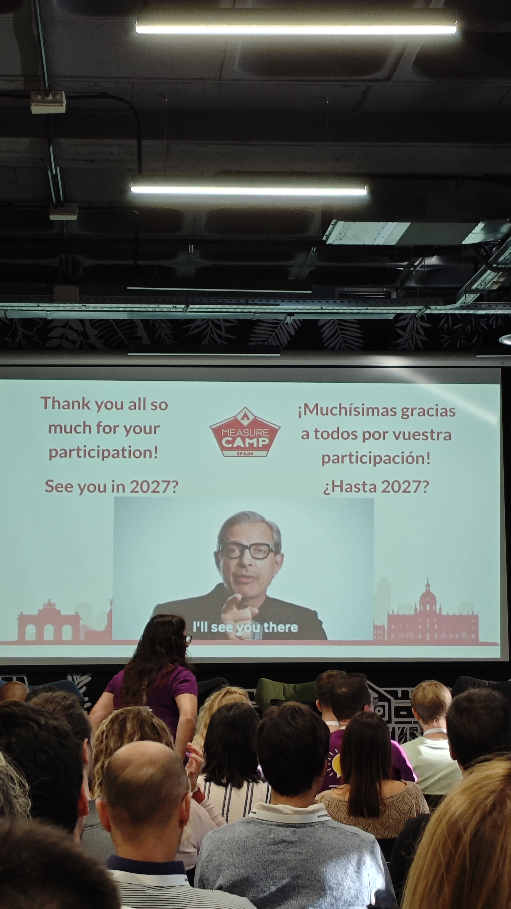

Ya hace más de una semana que fue MeasureCamp Madrid 2026 y quería hacer una especie de recopilación de lo que pude ver. Puede que me perdiese alguna presentación en la que se hablase de alguno de estos temas.

Vi en muchas tarjetas el tema del tracking server-side. Me hizo pensar en los huecos que tenemos en los datos y en lo difícil que se vuelve decidir cuando no sabemos bien a quién estamos dejando de observar. El server-side puede cambiar cómo recogemos las señales; por sí solo no nos dice cuánto hemos perdido ni convierte una muestra incompleta en una población completa.

Asistí, por ejemplo, a una desconferencia de Ana Soplón y Sarah Maza. Mencionaron de pasada cómo cruzar fuentes puede enriquecer el recorrido de un usuario. Me quedé pensando en eso: una fuente te cuenta una parte; otra puede completar la historia. También hay que saber cuándo dos piezas no encajan, aunque juntas puedan hacer un dashboard precioso.

La otra temática fue la IA. Los comentarios que oí eran que alucina, que hace malos análisis, que los MCP no están bien... Muchas de estas cosas tienen su parte de razón, pero también hay que hablar de la otra parte que puede estar dando fallos: los humanos. Veámoslo con dos ejemplos:

Uno: ¿por qué en ninguna de las sesiones a las que asistí se habló de [Claude Dashboards](https://support.claude.com/en/articles/17454700-get-started-with-claude-dashboards)? Me hubiera gustado asistir a una charla en la que se hubiera hablado del impacto que Claude Dashboards tiene para un analista. ¿Qué parte de nuestro trabajo era levantar ese primer dashboard? ¿Qué parte empieza cuando alguien pregunta si el número tiene sentido? ¿El analista hacía las dos partes y ahora solo hace una?

Dos: los MCP. Es cierto que pueden consumir más tokens de los necesarios, igual que pueden llenar la ventana de contexto de información innecesaria y hacer que la respuesta a nuestra pregunta pierda sentido. Pero, en lugar de apuntar solo a esos errores, podríamos hablar de las mejores integraciones que permiten. También de cómo algunos clientes de MCP ya [cargan dinámicamente sus herramientas](https://platform.claude.com/docs/en/agents-and-tools/tool-use/tool-search-tool), sin sobrecargar la ventana de contexto, o de cómo Pi agent las encapsula gracias a su funcionalidad [codemode](https://pi.dev/docs/latest/codemode), sin tanto consumo de tokens. Por favor, seamos serios y digamos que a MCP todavía le falta por mejorar, y reconozcamos sus limitaciones. Pero no le echemos toda la culpa: los humanos también tenemos parte de responsabilidad.

Recuerdo cuando monté por primera vez un MCP para consultar GA4. La conexión funcionaba. Entonces alguien preguntó por un key event usando el nombre que empleaba su equipo. En la propiedad de GA4 tenía otro nombre. Creo que los humanos tenemos el concepto equivocado de que, cuando aparece una funcionalidad, va a hacer magia y todo lo va a hacer por nosotros.

Siempre me ha gustado trabajar con las máquinas porque, cuando fallan, siempre te muestran qué error están dando. Los humanos, en cambio, no tienen ese log que nos ayude, y a veces tenemos que invertir más tiempo que con una máquina en descubrir qué estaba fallando.

Voy a seguir señalando los fallos de la IA. Pero también quiero que seamos honestos con nosotros mismos y señalemos los fallos de los humanos. Nuestro trabajo, muchas veces, se ha podido resumir en ser traductores entre la parte de negocio y la parte técnica. Puede que ahora, cuando la IA nos facilita más herramientas, acabemos siendo una piedra de Rosetta para los tres idiomas. Ahí hay trabajo para quienes venimos de la analítica: hacer preguntas mejores, poner nombres que todos entiendan y construir sistemas que sepan decir «no lo sé».

Todavía estoy intentando averiguar cómo cambia eso nuestro oficio. Prefiero hablarlo ahora que esperar a que otro dashboard me dé la respuesta.

---

*Estas son mis opiniones personales, no las de mi empleador. Ya me he equivocado antes – no dudéis en decirme que me equivoco otra vez.*